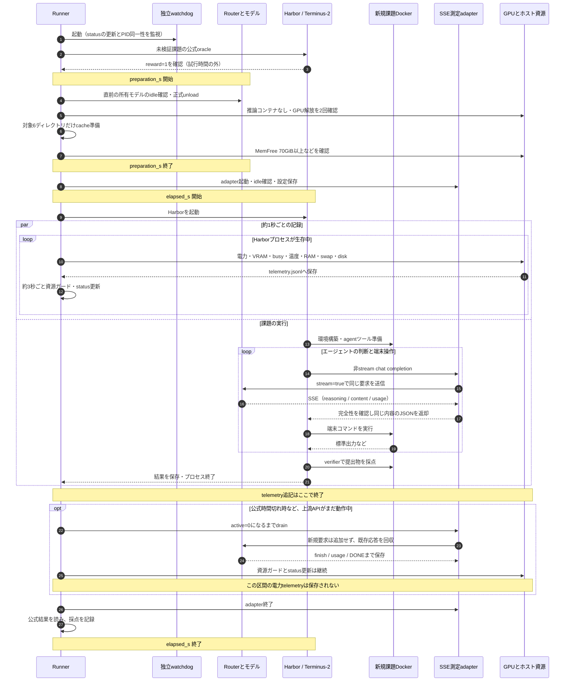
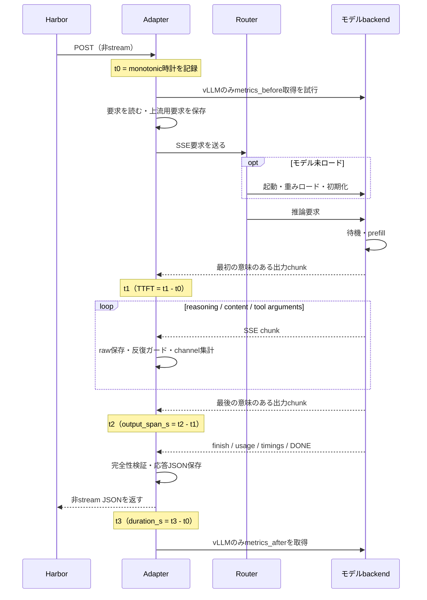
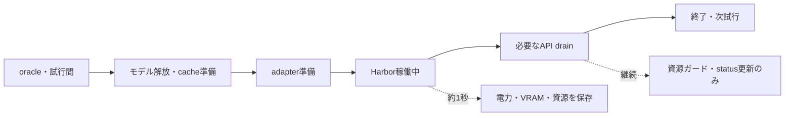

# 実行速度と資源の計測方法

本記録には、試行全体の実時間、APIの応答待ち、生成速度、GPUの電力量という異なる尺度があります。**TTFTやtok/sだけで課題の完了時間は決まりません。** 以下は新メモリ準備導入後のrunnerの計測位置です。初期8試行は準備条件が異なります。

## 1. 試行全体のシーケンス



`elapsed_with_preparation_s = preparation_s + elapsed_s`。この和も全工程の壁時計時間ではありません。oracle、adapter起動後の1秒待ち、設定書き出し、試行間の待機、復旧調査などは和の外にあります。初期8件のpreparation_sは欠測で、0ではありません。memory-recovery02だけは準備記録の時刻差から復元しました。

公式agent制限はHarborの`agent_execution`に適用されます。モデルをcold起動する最初のAPIもこの制限内です。時間切れ後のdrainはagentが解答を進められる追加時間ではありません。採点は公式終了時点の提出物に対して行い、遅れて完成したAPIは計測証拠として回収します。

独立watchdogは約2秒ごとにrunnerのPID/start timeとstatusを確認し、90秒更新停止や死亡時に所有プロセスを停止します。正常終了時にwatchdog/PIDが消えることは障害ではありません。

## 2. 1 APIのTTFTと出力時間



「意味のあるchunk」はcontent、reasoning、tool引数の文字列、またはtool関数名を含むイベントです。ロールだけのchunk・usageだけのchunkは最初の出力としません。SSE chunkはtoken単位とは限りません。raw SSEには各chunkの時計は埋め込まれておらず、TTFT等は実行時のadapterが別途記録しています。

TTFTの起点はadapterが要求を処理し始めた時点です。要求本文の読込み、記録、metrics_before取得、router、cold起動、待ち時間、prefillを含み得ます。Harbor側の送信前処理は含みません。duration_sは下流JSON送信処理までを含みますが、その後のmetrics_after取得は含みません。

| 指標 | 定義 | 読み方 |
| --- | --- | --- |
| cold first TTFT | 新準備条件で各試行の最初のAPIの`t1-t0` | モデルの起動を含む体感待ち |
| later TTFT | 同じ試行内の2件目以降の`t1-t0` | 入力内容・長さ・cache状態は異なる |
| 観測output tok/s | `sum(completion_tokens) / sum(output_span_s)` | chunk間の時間による全応答加重値。純粋な1-token decode latencyではない |
| Strata prefill tok/s | `sum(prompt_n) / (sum(prompt_ms)/1000)` | backendの実timings。cached分の入力総数とは異なる |
| Strata decode tok/s | `sum(predicted_n) / (sum(predicted_ms)/1000)` | backendの実timings。投機生成の構成を含む |
| vLLM decode tok/s | `sum(delta generation_tokens_total) / sum(delta request_decode_time_seconds_sum)` | 前後metricsが両方ある要求だけ |

### 実測値

| 指標 | IQ4_XS | IQ3_S | 27B |
| --- | --- | --- | --- |
| 新準備条件・初回TTFT中央値 秒 | 24.78 (54件) | 23.79 (55件) | 104.08 (54件) |
| 後続TTFT中央値 秒 | 0.98 | 0.93 | 0.77 |
| 観測output tok/s | 74.6 | 70.2 | 164.7 |
| Strata prefill tok/s | 570.6 | 604.3 | 該当なし |
| Strata decode tok/s | 74.5 | 70.1 | 該当なし |
| vLLM metrics decode tok/s | 該当なし | 該当なし | 161.6（538要求） |

vLLMは595要求中、起動前backendが存在しない最初の57要求でmetrics_beforeが欠け、538要求のみ差分を集計しています。prefill時間の差分合計は452.401秒。prompt counterはcache済み分を含み、未cacheトークン数が取れていないのでStrataのprefill tok/sと直接比較していません。

全モデルで最初の呼出しごとにcoldにする運用のため、27Bの速い出力速度が試行全体の短さには直結しません。この試験からwarm常駐時の課題完了時間は推定できません。

## 3. トークンの数え方

[APIデータ](../reports/terminal-bench-20261007/data/api-audit.json)のusageを足した「上流実測」と、[試行データ](../reports/terminal-bench-20261007/data/trials.json)のHarbor使用量は区別します。

- 上流usageはthinkingを含むcompletion、長さ上限に達した応答、時間切れ後に回収した応答も含みます。同じ履歴を毎回渡すprompt_tokensは累積入力数です。
- Harborの実装はfinish_reason=lengthでLLMResponseの返却前に例外を発生させます。受取りの中断等もあり、agent側の集計から一部が漏れます。
- `length`でもusage/finish/DONEが揃っていればSSEは完全です。タスク成功とは別概念です。
- 27Bはprefix cache ONですが、usageにcached_tokensがありません。集計中の0を「cacheヒットなし」と解釈せず、レポートでは未取得としています。

## 4. GPU電力量と計測の空白

GPU2枚の`power1_average`（μW）を約1秒ごとに読み、合計Wに直して実時刻差で台形積分します。

```text
P_i [W] = (GPU0.power1_average + GPU1.power1_average) / 1,000,000
Wh = Σ ((P_i + P_(i+1)) / 2) × (t_(i+1) - t_i) / 3600
```



記録されたGPU WhはIQ4 **699.56 Wh**、IQ3 **698.89 Wh**、27B **866.01 Wh**。elapsed合計に対する記録時間比は98.51%、98.62%、98.65%ですが、電力も同じ比率で補正できるとは限りません。

Harbor終了後のAPIが2秒以上未記録区間に続いた試行は1/3/2件、記録末尾からAPI終了までの合計は174.8/145.0/169.7秒（IQ4/IQ3/27B）。準備・oracle・試行間・採点外中断も積算対象外です。CPU・RAM・ストレージ・電源損失を含む壁コンセントでの全ホスト電力ではありません。今回のWhから完全な電力効率順位を作らないでください。

実装の対応箇所は[runner](../reference/harness/terminal_bench_runner.py)のHarbor監視loop/draining、[adapter](../reference/harness/terminal_bench_relay.py)のdo_POST、[StreamEvidence](../reference/harness/iq3s_stability_replay.py)のevent/metrics、[集計](../reference/harness/terminal_bench_aggregate.py)の台形積分です。参照コードのホストパス/アドレスは公開用に置換しています。
